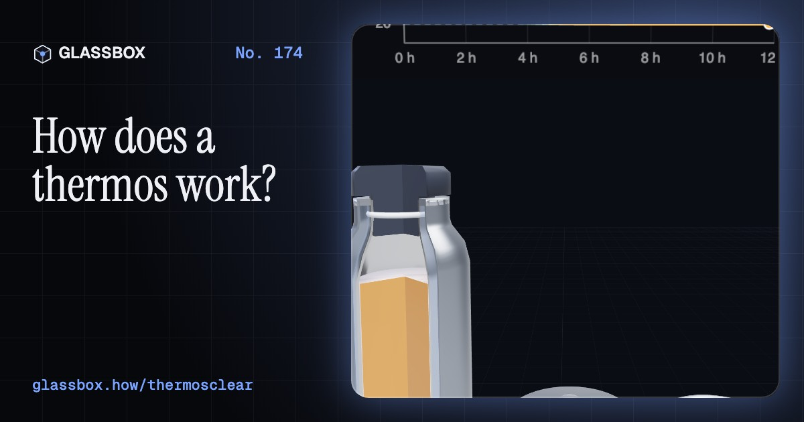
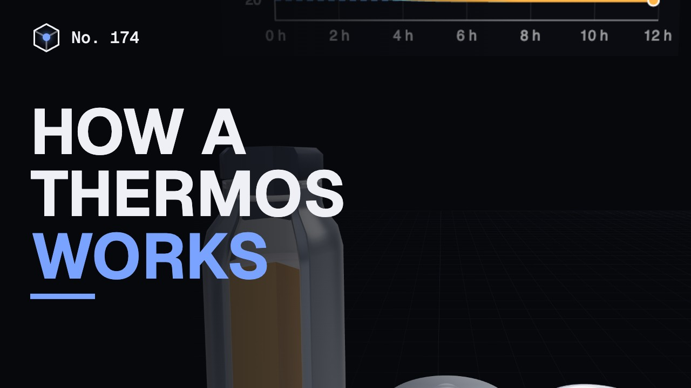
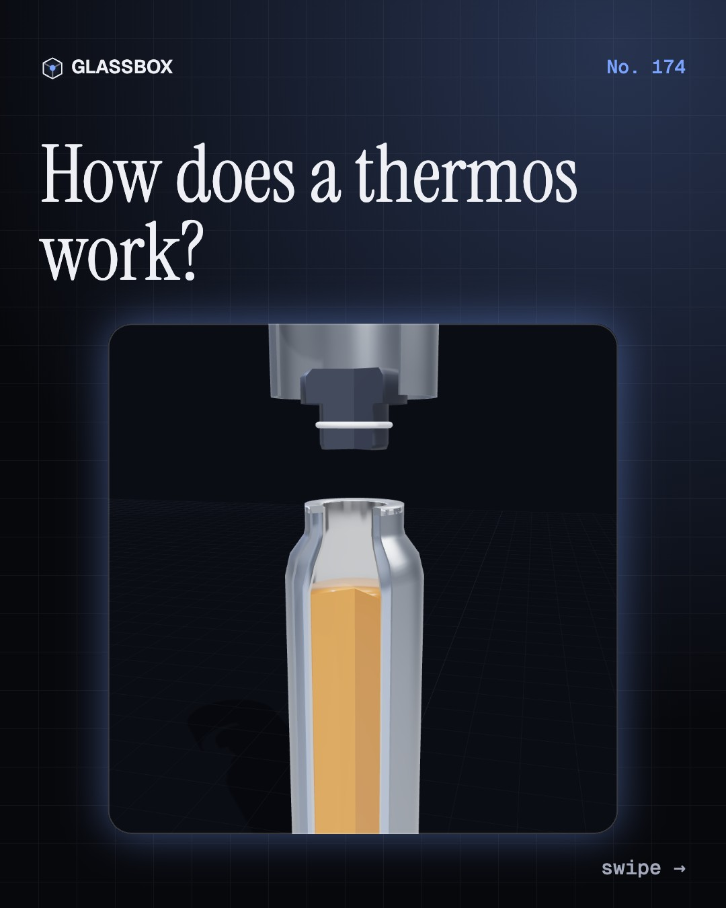
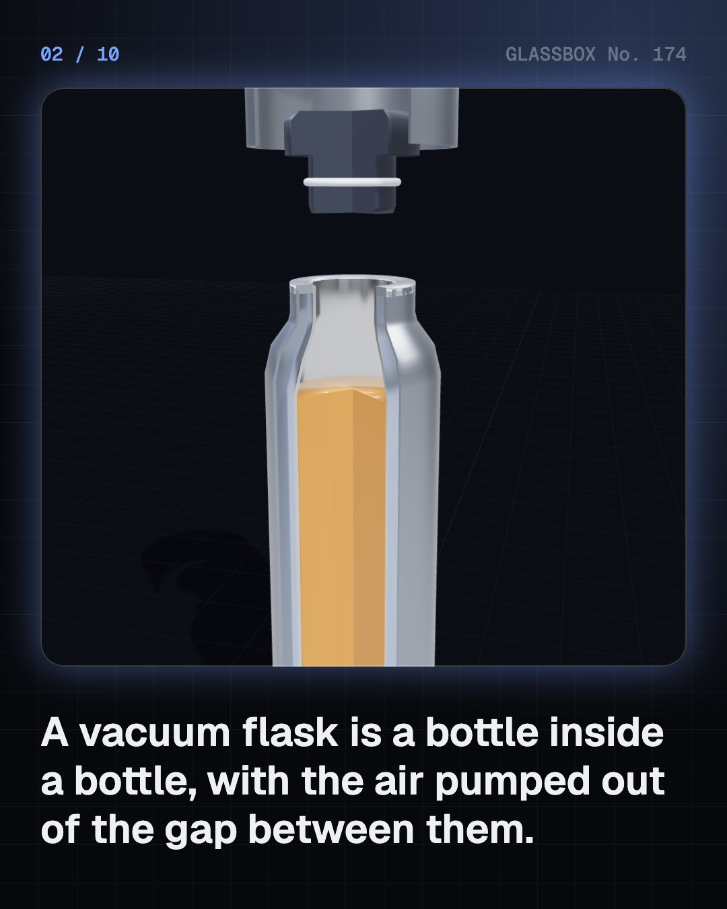
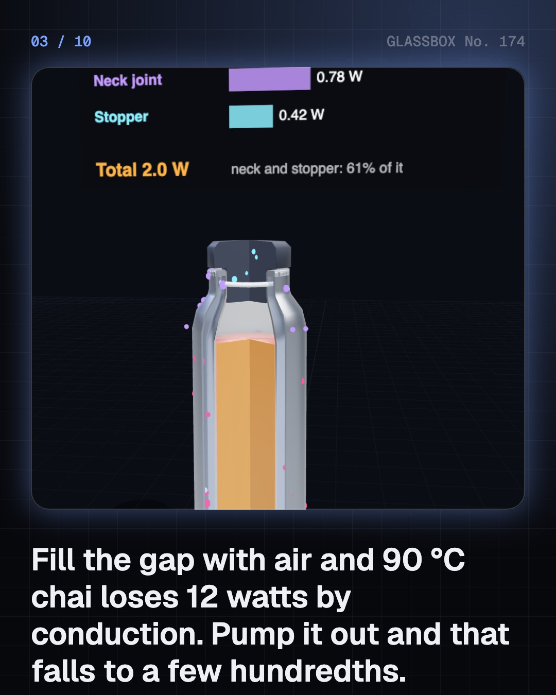
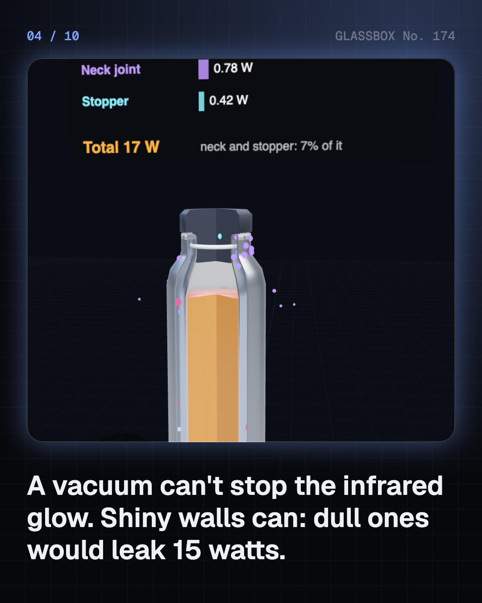

<!-- glassbox:start -->
<!-- Generated from glassbox.json by the Glassbox hub (npm run readme -- thermosclear). Edit glassbox.json, not this block. -->
<p align="center"><a href="https://glassbox.how/e/thermosclear/"></a></p>

<h1 align="center">ThermosClear</h1>

<p align="center"><b>How does a thermos work?</b><br>A steel flask keeps chai hot from breakfast to teatime with nothing at all: a gap emptied of air, two mirror-bright walls and a good stopper. Block heat's three escape routes in 3D, run twelve hours in twenty seconds, and find out why a fizzy drink should never go in one.</p>

<p align="center"><a href="https://glassbox.how/thermosclear/"><b>▶ Play with it</b></a> &nbsp;·&nbsp; <a href="https://glassbox.how/e/thermosclear/">Read the 60-second explainer</a> &nbsp;·&nbsp; <a href="https://glassbox.how/thermosclear/glassbox/reel.mp4">Watch the 40-second video</a></p>

<p align="center">
  <a href="https://glassbox.how/e/thermosclear/"></a>
  <a href="https://glassbox.how/e/thermosclear/"></a>
  <a href="LICENSE"></a>
  <a href="LICENSE-CONTENT.md"></a>
  <a href="#privacy"></a>
</p>

## In 60 seconds

1. **A bottle inside a bottle.** A vacuum flask is two bottles, one inside the other, joined only in a thin ring at the neck. The air between them has been pumped out, the facing walls are shiny, and a stopper closes the mouth. All-steel flasks weld two steel bottles together; older ones hold a silvered glass refill in a case.
2. **Three escapes, three blocks.** Heat leaves by conduction, convection and radiation. The vacuum stops the first two: with the 5 mm gap full of air, 90 °C chai would lose about 12 W by conduction, and with a vacuum only hundredths of a watt. Radiation crosses a vacuum, so the walls are shiny: dull walls would leak about 15 W, polished steel about 0.7 W.
3. **The real leaks: neck and stopper.** Where the vacuum can't reach, heat still gets out: along the neck, where the walls are joined, and through the stopper. In a good 500 mL steel flask they carry over half of the roughly 2 W it loses at 90 °C.
4. **Slow cooling, not no cooling.** A flask cools along the same curve as any hot drink, about twenty times more slowly than a jug with a lid. Started at 95 °C in a 20 °C room, a good steel flask is near 75 °C after 6 hours and 60 to 65 °C after 12. Half-full, it cools about twice as fast.
5. **Making and losing the vacuum.** Removing half the air does nothing: conduction only falls once the gas is so thin that molecules cross the gap without meeting, below about 1 pascal. Steel flasks are sealed in a vacuum furnace with a getter to soak up stray hydrogen. If the outside of a flask gets warm, the vacuum has gone.
6. **Use it safely.** Hot drinks in a flask stay hot enough to scald for hours. Never seal in a fizzy or fermenting drink: its gas can push on a 4 cm stopper like a weight of tens of kilograms. Food kept warm should stay above 60 °C, as the WHO advises.

## Words worth knowing

| Term | Meaning |
|---|---|
| **Vacuum flask** | A double-walled bottle with the air pumped out of the gap between the walls. Often called a thermos, a former trademark that became an everyday word. |
| **Conduction** | Heat passed on by molecules bumping into their neighbours. A vacuum has almost none to pass it on. |
| **Radiation** | Heat carried by infrared light, which crosses a vacuum. Shiny walls block it. |
| **Emissivity** | How strongly a surface glows in the infrared, from 0 to 1: about 0.03 for silvered glass, 0.075 for polished steel, 0.9 for a dull surface. |
| **Mean free path** | How far a gas molecule travels before hitting another. In a good flask's gap it is longer than the gap itself. |
| **Newton's law of cooling** | Heat flows out at a rate proportional to the temperature difference, so hot things cool fast at first and then slower. |
| **Time constant** | Heat stored divided by heat lost per degree: about 20 hours for a good 500 mL steel flask, under an hour for a jug. |
| **Getter** | A reactive metal sealed into a vacuum to soak up gas that seeps out of the walls later. |
| **Danger zone** | About 5 to 60 °C, where germs in food multiply fastest. The WHO advises keeping cooked food above 60 °C. |

## A short history

**From a tube of mercury in 1643 to a laboratory bottle of liquid air in 1892, and the steel flask in every Indian office bag.**

- **1650** · The first air pump (Otto von Guericke, Magdeburg, Germany)
- **1804** · Shiny surfaces glow less (John Leslie, Edinburgh, Scotland)
- **1892** · Dewar's vacuum flask (James Dewar, Royal Institution, London)
- **1898** · Liquid hydrogen, kept in a flask (James Dewar, Royal Institution, London)
- **1903** · A flask for everyday use (Reinhold Burger, Germany)
- **1904** · The name Thermos (Reinhold Burger, Germany)
- **1963** · The appeal court agrees (US Court of Appeals, Second Circuit, New York, USA)
- **1978** · The first stainless steel vacuum bottle (Nippon Sanso, Japan)

The full story, with 23 moments, charts, people and 19 sources: [glassbox.how/e/thermosclear/history](https://glassbox.how/e/thermosclear/history/). The data lives in [`history.json`](history.json).

## Video and slides

Made with the Glassbox studio from this box's storyboard (`window.glassbox.director`). Free to reuse under CC BY 4.0.

<a href="https://glassbox.how/thermosclear/glassbox/video.mp4"></a>

<p><a href="glassbox/slide-1.jpg"></a> <a href="glassbox/slide-2.jpg"></a> <a href="glassbox/slide-3.jpg"></a> <a href="glassbox/slide-4.jpg"></a></p>

| File | What | Size |
|---|---|---|
| [`glassbox/reel.mp4`](https://glassbox.how/thermosclear/glassbox/reel.mp4) | Reel / Short, with captions and soundtrack | 1080×1920 |
| [`glassbox/video.mp4`](https://glassbox.how/thermosclear/glassbox/video.mp4) | YouTube video, with captions and soundtrack | 1920×1080 |
| `glassbox/slide-1…10.jpg` | Instagram carousel | 1080×1350 |
| `glassbox/thumb.jpg` | YouTube thumbnail | 1280×720 |
| `glassbox/cover.jpg` | Share card and repo social preview | 1200×630 |
| [`glassbox/history-reel.mp4`](https://glassbox.how/thermosclear/glassbox/history-reel.mp4) | “History in 10 moments” Reel / Short | 1080×1920 |
| `glassbox/history-slide-*.jpg` | History carousel | 1080×1350 |
| `glassbox/post.json` | Post copy and schedule used by the publish kit | |

## Privacy

This box has no accounts and no ads, and it ships its own fonts and libraries. When you run it yourself it sends nothing anywhere. On glassbox.how, the site's `/bar.js` also loads Glassbox's analytics: **Google Analytics** to count visits (it asks first in the EU, UK and Switzerland, and stays off when your browser sends Global Privacy Control or Do Not Track) and **ClickTrust** to detect bots.

It remembers a few things **in your own browser only**, and never sends them anywhere:

| Browser storage key | What it holds |
|---|---|
| `thermosclear.v1` | Which chapters you have opened, your best quiz scores, and sound on or off. |

Exactly what each one sees is at [glassbox.how/privacy](https://glassbox.how/privacy/).

## Licences

- **Code:** [MIT](LICENSE). Use it, change it, ship it.
- **Explanations, text, images and videos** (`glassbox.json`, `glassbox/`): [CC BY 4.0](LICENSE-CONTENT.md). Credit “Glassbox, glassbox.how/e/thermosclear”.
- **Third-party parts** keep their own licences: [three.js](https://threejs.org) (MIT), [Geist, Instrument Serif](https://openfontlicense.org) (SIL OFL 1.1).
- The Glassbox name and logo aren't covered by either licence. See the [terms](https://glassbox.how/terms/).

Found a mistake? [Open an issue](https://github.com/bdeeps/thermosclear/issues). Corrections happen in public.
<!-- glassbox:end -->

## Run it

It's plain HTML, CSS and JavaScript. No build step and no dependencies. Run locally, it contacts no other website.

```bash
python3 -m http.server 8000
```

Three.js and the fonts ship in `vendor/` and `fonts/`, so it also works offline.

Then open http://localhost:8000.

## How it's built

| File | What |
|---|---|
| `index.html`, `css/app.css` | The page and its styles |
| `js/app.js`, `js/stage.js`, `js/ui.js`, `js/kit.js` | The shared Glassbox 3D engine: chapters, 3D stage, controls, quiz, video director |
| `js/chapters/*.js` | One file per chapter: the 3D model, controls, text, key terms, quiz and video scenes |
| `js/thermos.js` | ThermosClear's own parts: the flask's heat budget (gas, radiation, neck, stopper), cooling curves, the generic 3D flask, chart boards |
| `glassbox.json` | Title, question, explainer beats, key terms, browser storage and credits shown on glassbox.how |
| `reel` in each chapter | The storyboard the Glassbox studio records into short videos |
| `glassbox/` | The published video, slides, thumbnail and post copy |
| `fonts/`, `vendor/three/` | Self-hosted Geist and Instrument Serif (SIL OFL 1.1) and three.js (MIT) |
